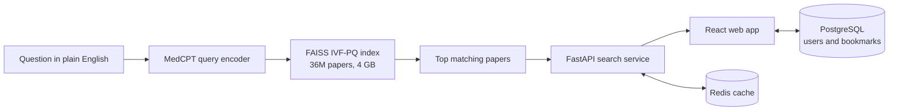

<!-- ============================== HEADER ============================== -->

  

  

  
  
  

  
  
  
  

---

## 👋 About me

<table>
<tr>
<td width="58%" valign="top">

I'm a final-year **B.E. Artificial Intelligence and Machine Learning** student at **Sri Krishna College of Technology**, Coimbatore.

I build **AI agents and the systems around them**: multi-agent workflows in LangGraph, MCP servers that give AI assistants new tools, and RAG pipelines over real data. With a team of 8, I built a search engine that answers questions over **36 million** medical papers on a single cloud server.

I'm looking for an **AI/ML Engineer** or **AI Agent Developer** role where I can ship working systems from day one.

</td>
<td width="42%" valign="top">

| | |
|---|---|
| 🏅 | **GitHub Certified:** Agentic AI Developer |
| 📜 | **17** certifications |
| 🛡️ | **1** Government of India registered design |
| 💼 | Data Scientist Intern, Postulate Info Tech |
| 🤖 | **5** AI agents built in one day |

</td>
</tr>
</table>

---

## 🚀 Featured projects

<table>
<tr>
<td width="50%" valign="top">

### 🩺 [MedScholar](https://github.com/vinoth322006/MedScholar)
Ask a medical question in plain English and get the most relevant papers from **36 million** PubMed articles. Built with a team of 8 at the **Cognizant Hackathon 2026**.

`MedCPT` `FAISS` `FastAPI` `React` `PostgreSQL` `Redis` `AWS`

</td>
<td width="50%" valign="top">

### 🧠 [Adaptive Research Agent Swarm](https://github.com/vinoth322006/Adaptive-research-agent-swarm)
A coordinator splits a research problem between **8 specialist AI agents**. Reviewer agents then debate and score every idea on 6 criteria such as novelty and feasibility.

`LangGraph` `FastAPI` `Gemini`

</td>
</tr>
<tr>
<td width="50%" valign="top">

### 📋 [Caseworker Morning Agent](https://github.com/vinoth322006/caseworkers-morningsvg)
An auditable agent that sorts case referrals into **allowed, hand-off or escalated** using written policy rules, and logs the reason for every decision.

`LangGraph` `Python`

</td>
<td width="50%" valign="top">

### 🔌 [Unstop MCP Server](https://github.com/vinoth322006/unstop-mcp-server)
Lets **Claude, Cursor** and other MCP clients search Unstop contests and analytics. Runs on mock data until Unstop opens a public API.

`Python` `MCP SDK` `FastAPI`

</td>
</tr>
<tr>
<td width="50%" valign="top">

### 💬 [RAG Chatbot API](https://github.com/vinoth322006/Ai-chatbot)
Upload PDFs and ask questions about them. Answers come from the documents through vector search, with secure JWT login. A [second version](https://github.com/vinoth322006/Sws-Ai-RAG-chatbot) supports five LLM providers.

`FastAPI` `PostgreSQL` `pgvector` `Gemini` `Docker`

</td>
<td width="50%" valign="top">

### 📱 [TechiesLog](https://github.com/vinoth322006/techieslog)
Open-source Android app for tasks, habits and budgets that works **100% offline**, with no ads or tracking.

`Flutter` `Dart`

</td>
</tr>
</table>

<b>🔍 How MedScholar works (click to expand)</b>

 

The 36 million paper vectors took over 150 GB. Compressing them with **IVF-PQ quantization** brought the index down to 4 GB with little accuracy loss, so the whole system runs on one affordable AWS EC2 server and answers in under 1.5 seconds.

<b>🧰 More things I've built (click to expand)</b>

 

| Project | What it does | Built with |
|---|---|---|
| [AUTOMAIL](https://github.com/vinoth322006/AUTOMAIL) | AI cold-email assistant for job hunting, with a dashboard, template rotation and bounce detection | Python, LLM APIs |
| [Edge Camera Server](https://github.com/vinoth322006/edge_camera_server) | Raspberry Pi hotspot that streams live crowd density from a camera to any phone | FastAPI, OpenCV, WebSockets |
| [Intellishot](https://github.com/vinoth322006/Intellishot) | Turns screenshots into structured notes with Gemini and exports to Notion or Obsidian | Flutter, Gemini |
| [MCP Chat](https://github.com/vinoth322006/MCP) | One chat UI for several LLM providers, with MCP servers added at runtime | JavaScript, MCP |
| [E-Wallet](https://github.com/vinoth322006/E-wallet-management-app) | Wallet app with JWT auth, role-based access and admin analytics | Spring Boot, React |
| [LocalAI Client](https://github.com/vinoth322006/localai-client) | Python client and web UI for running local LLMs | Python |
| [NeetCode solutions](https://github.com/vinoth322006/neetcode-submissions) | My data structures and algorithms practice | Java |

---

## 🛠️ Tech stack

   
  

<table align="center">
<tr><td><b>🤖 AI and agents</b></td><td>LangGraph · LangChain · CrewAI · MCP · OpenAI Agents SDK · RAG · LoRA / PEFT fine-tuning</td></tr>
<tr><td><b>📊 Machine learning</b></td><td>PyTorch · TensorFlow · Scikit-learn · Hugging Face · OpenCV · YOLOv8</td></tr>
<tr><td><b>⚙️ Backend and data</b></td><td>FastAPI · Node.js · React · PostgreSQL · pgvector · FAISS · Redis</td></tr>
<tr><td><b>☁️ Cloud and tools</b></td><td>AWS · Azure · Docker · Linux · Git · Raspberry Pi</td></tr>
</table>

---

## 🏅 Certifications

  
  
  
   
  
  
  

  🎓 NPTEL Big Data Computing: <b>Elite + Gold, course topper</b> &nbsp;·&nbsp; NPTEL Cloud Computing: <b>Elite + Silver, top 7%</b> &nbsp;·&nbsp; and 9 more

---

## 🏆 Achievements

| | Achievement | Details |
|:-:|---|---|
| 🛡️ | **Registered design No. 421785-002** | Government of India, 2024. Co-inventor of a baby chair with a built-in safety airbag |
| 🤖 | **Agent Build Day 2025** | Built and published 5 AI agents in one day at HackerEarth × Agent.ai, Bengaluru |
| 🥈 | **2nd place, Science Expo 2024** | A virtual mouse controlled by finger gestures, built with Python and OpenCV |
| 🏁 | **Finalist, Anveshana Science Expo** | Top 35 of 318 teams, and the only first-year team in the final |
| 🌱 | **Finalist, TNPCB Bag-It Hackathon** | Top 15 of 300 teams, Tamil Nadu Pollution Control Board |
| 🎤 | **Campus Ambassador, IIT Bombay** | Raised event participation from our campus by 20% |

---

<b>📈 GitHub activity (click to expand)</b>

 

  
  
  

---

## 🤝 Let's connect

  I'm open to <b>AI/ML Engineer</b> and <b>AI Agent Developer</b> roles and internships. 
  The fastest way to reach me is email or LinkedIn.

  
  
  

  

